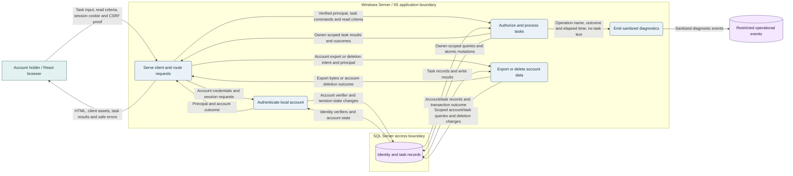
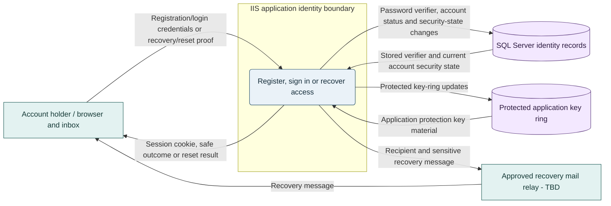
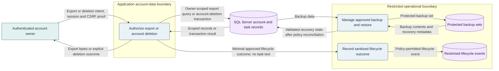

# Task Manager Proposed Architecture

## Status and source authority

- **Status:** Proposed architecture, not approved for implementation.
- **Version:** 0.1
- **Sources:** [Requirements v0.5](task-manager-product-requirements.md) and [conditional implementation plan v0.2](task-manager-implementation-plan.md), plus the user's architecture clarification answers recorded in the [chat log](../ai-logs/2026/11/13/task-manager-prd-20261113-061750/conversation.md).
- **Confirmed direction:** ASP.NET Core, React/TypeScript, SQL Server, self-hosted Windows Server with IIS, application-managed accounts/passwords, self-registration, password recovery, and durable saved data across reopening and later sign-in.
- **Current state:** No application, schema, deployment, or executable application test suite has been established by this work.
- **Unconfirmed:** Exact product/library versions, SQL Server edition/topology, identity policies, mail delivery, owners, budget, workload/concurrency, availability/recovery targets, and retention/deletion policy.

The [ASP.NET Core guide](../.github/instructions/aspnet-core.instructions.md) and [React guide](../.github/instructions/react-typescript.instructions.md) contain conflicting workspace/device-pairing guidance and references to a missing root architecture file; the backend guide also assumes PostgreSQL. The user explicitly directed this proposal to follow the current PRD and clarification answers instead, flagging those guides without editing them. Reconciliation remains an implementation-readiness gate, not evidence that the old design is approved.

## Goals and constraints

Deliver a private, authenticated personal task manager with task capture/editing, active/completed views, completion/reopening, archive/restore, optional date-only due dates and free-text project names, and account-level export/deletion. Registration and password recovery are account capabilities, not task notifications.

Keep the PRD's exclusions: no shared workspaces, task assignment, linked project lists, priorities, labels, subtasks, recurring tasks, task reminders, task integrations, attachments, offline mode, reporting UI, or individual-task permanent deletion.

The supplied performance target is provisional: list/save actions at p95 under 2 seconds with 500 tasks per user. The supplied usability target is at least 90% unaided create/edit/complete task success. Neither target has approved measurement conditions or measured evidence. Target WCAG 2.2 AA and English UI with locale-aware dates, subject to policy confirmation. Do not infer a compliance certification, uptime target, or user count.

## Architecture overview

**Recommendation:** A modular monolith: one ASP.NET Core web application, one React/TypeScript client served from the same origin, and one SQL Server application database. Use logical modules and end-to-end feature slices, not independently deployed microservices.

- **React:** Typed forms, task views, accessible account workflows, transient drafts, and explicit loading/saving/error/conflict states.
- **ASP.NET Core:** Same-origin HTTP endpoints, local identity/session handling, owner-scoped task operations, validation, account export/deletion, and sanitized diagnostics.
- **SQL Server:** Authoritative committed task and identity data. Application memory and browser state are not durable task stores.
- **Recovery delivery:** An approved mail relay is a proposed infrastructure dependency. Its address, trust requirements, and operational owner are [NEEDS DECISION]; no mail service is assumed to exist.
- **IIS:** HTTPS entry point and ASP.NET Core hosting. Keep browser-to-database access impossible.

### Component boundary and task data flow

The browser is untrusted. IIS/application processing, the SQL Server host, and operational storage are separate trust/access boundaries even if development co-locates them. Database access always passes through application processes.

Legend for all diagrams: teal rectangles = external actor/system; blue rounded nodes = application/operational process; purple cylinders = persistent store. Shapes and labels retain meaning without color.

### Task reads, writes, and refresh

1. Authenticate the account and verify it is still active; obtain the owner identifier from server-validated identity, never from a browser-supplied ownership field.
2. Read tasks using an owner predicate plus approved completion/archive criteria. Return only permitted fields and bounded results. Sorting, paging contract, and archive visibility remain review decisions.
3. Validate a mutation server-side; commit the owner-scoped change and version together. Return the committed state/version only after success.
4. Propose optimistic concurrency using SQL Server `rowversion` and an opaque HTTP entity tag. Require the current version for edits and state changes; return an explicit conflict for stale data while retaining the user's draft.
5. On reopening or later sign-in, read SQL Server state. Propose refetch on app entry, return to the view, and explicit refresh; no polling, push service, or offline write queue is needed for v1.
6. Prevent stale responses from overwriting newer confirmed state. Show save success only after server confirmation; a lost response may have an ambiguous outcome. Propose a per-owner create-operation key to deduplicate retries; finalize replay/conflict semantics before implementation.
7. Preserve unsaved input in memory on failure. Do not silently persist task content to browser storage. Disconnected feedback and retry UX remain [NEEDS DECISION].

## Component design and technology recommendations

| Component | Responsibility and recommendation | Decision status |
|---|---|---|
| Client | React/TypeScript with strict typing, semantic HTML, reusable form/error presentation, and a small typed API boundary. No HTML injection from task text. | Frameworks confirmed; build tooling, component/test libraries, versions TBD. |
| Web/API | C# and ASP.NET Core, feature-oriented modules for Account Access, Tasks, and Account Data Lifecycle; shared error/authentication mechanisms. Controllers versus minimal APIs remains an implementation choice. | Framework confirmed; modular-monolith organization proposed. |
| Local identity | Propose ASP.NET Core Identity and its maintained password-verification/token mechanisms rather than custom password cryptography. Separate account records from task fields. | Local accounts, self-registration and recovery confirmed; library/configuration proposed. |
| Session boundary | Propose server-issued Secure, HttpOnly cookies and anti-CSRF checks on unsafe operations. Same-origin hosting avoids a separate browser bearer-token store and unnecessary cross-origin configuration. | Proposed; lifetime, renewal, lockout, rate limits and SameSite policy require review. |
| Persistence | Propose Entity Framework Core with its SQL Server provider, reviewed migrations, explicit ownership predicates, SQL constraints, and transactional writes. Avoid a second persistence abstraction unless actual reuse warrants it. | SQL Server confirmed; data-access/migration libraries and versions proposed. |
| Recovery channel | Application recovery process hands a sensitive message to an approved mail relay. No task reminders or general notification subsystem. | Recovery confirmed; relay, delivery mechanism, sender, verification and token handoff TBD. |
| Operations | IIS/application health checks, restricted structured logs, operation timing/outcome metrics, SQL backup/restore procedures, and protected application cryptographic keys. | Capabilities proposed; tooling, owners and retention TBD. |

Select mutually compatible, organization-supported versions during implementation readiness. This proposal makes no claim about current vendor support windows, pricing, licenses, or the latest release.

### Proposed data model

| Logical record | Data and invariants |
|---|---|
| Identity account and framework identity records | Stable internal account ID, approved login identifier, framework-managed password verifier/security state, and account status. Do not put task content in identity claims. Identifier rules, verification, password policy and security-event retention remain open. |
| Task | Task ID; required owner ID; title; optional description, project name and SQL `date` due date; completion state; independent archive state; concurrency version. Proposed operational metadata includes creation/update instants and create-operation key if approved. |
| Account-data policy state, if required | Only records needed to enforce approved deletion/export/recovery policy. Do not invent a retention period, deletion ledger, or indefinite audit store before the responsible policy owner decides the requirement. |

Use .NET date-only values and `YYYY-MM-DD` transport values for due dates; do not shift them through JavaScript timestamps or timezones. Format them for the selected locale. Operational event timestamps are UTC instants and are not due dates.

Keep project name as nullable task text, not a foreign key or project table. Completion and archive state are independent so the proposed restore behavior can preserve completion state by clearing only the archive marker; that product behavior still needs approval.

Require an account foreign key for each task. Recommend indexes starting with owner and actual status/archive query predicates; confirm ordering and query plans before choosing final index definitions. Parameterize access, enforce agreed field bounds in the API and database, and avoid unbounded task-list reads.

### Proposed interface shape

These are candidate contracts, not implemented endpoints or final request schemas.

| Surface | Proposed behavior |
|---|---|
| `POST /api/account/register`, `POST /api/account/login`, `POST /api/account/logout`, `GET /api/account/session` | Local registration/sign-in/sign-out and current account state; never expose password verifiers or raw session secrets to client JavaScript. |
| `POST /api/account/recovery/request`, `POST /api/account/recovery/reset` | Generic recovery-request outcome; approved recovery proof and a new password complete reset. Prevent account enumeration and proof replay. |
| `POST /api/tasks`, `GET /api/tasks`, `GET /api/tasks/{id}` | Create and retrieve owner-scoped tasks; list completion/archive criteria are explicit and validated. |
| `PUT /api/tasks/{id}` | Edit agreed task fields, with an explicit optional-field clearing contract and conditional version check. |
| `PUT /api/tasks/{id}/completion` | Set a target completion state; supports completing and reopening, rather than a retry-sensitive toggle command. |
| `PUT /api/tasks/{id}/archive` | Set target archive state; restoration is not permanent deletion. |
| `GET /api/account/export`, `DELETE /api/account` | Owner-only export and a separately protected destructive account-deletion operation. Export format, deletion timing, reauthentication and confirmation flow require review. |

There is no individual-task permanent-delete endpoint. Never accept a client-selected owner as authorization. Treat unknown and inaccessible task IDs consistently without disclosing another account's records. Recommend consistent non-sensitive problem responses for validation, authentication, unavailable records, conflicts, rate limits and failures; finalize status codes with contracts. Private API/export responses must not be cached in shared caches.

## Local credentials and recovery flow

Credentials and recovery proofs cross only the intended browser/application or recovery-channel boundaries. SQL Server stores approved identity verifiers/state, not plaintext passwords. A durable, protected key ring supports application cryptographic continuity across IIS restarts; it is not a substitute for password hashing.

- Propose framework-managed registration, credential verification and password reset. Login identifier and verified-address/activation requirements are [NEEDS DECISION], not invented business policy.
- Recovery must use a reviewed time-bounded, single-use proof and approved delivery channel; proof format/handoff, expiry, attempt limits and registration/recovery abuse controls remain implementation gates. Do not place raw credentials or recovery proofs in logs, analytics, persistent browser storage, or diagnostic URLs.
- Do not claim that recovery works until delivery failures, expired/used proofs, unknown accounts, and safe user feedback are tested. Do not return false delivery success when infrastructure failed; any generic user-facing outcome must coexist with explicit restricted operational failure reporting.
- Validate active account/session security state on protected requests. Propose invalidating affected sessions after password reset or account deletion. Identity-cookie validation must not leave a deleted account able to continue writing.
- Keep hashing, random-secret generation and cryptographic verification in maintained framework facilities. Numeric password, lockout, cookie lifetime, proof and rate-limit policy require an accountable owner.

## Account export, deletion, backup, and recovery

Account deletion and task archiving are separate operations. Recommend streaming a bounded owner-scoped export without persistent export files for v1 if approved data volume allows it; JSON is only a candidate format. Reassess background processing if measured data volume or policy makes synchronous handling unsafe.

Recommend account/task live-data removal within the approved transactional boundary, with active-account checks preventing new writes after deletion. Coordinate identity state, task rows, session invalidation and concurrent requests; account foreign keys must prevent orphan tasks. Do not rely on an unreviewed cascade rule.

Backup purge timing, retained audit data, export scope, deletion proof and legal/organizational obligations are [NEEDS DECISION]. Before restoring to live service, reconcile deleted-account state and invalidate or revalidate access so a restore cannot silently resurrect access/data contrary to policy. Determine whether independent minimal deletion records are required; this proposal does not assert such a mechanism exists.

## Architectural patterns and trade-offs

| Proposed choice | Fit | Trade-off or alternative |
|---|---|---|
| Modular monolith and feature slices | One small task domain, shared transactional data, and no confirmed independent scaling requirements. Maps to the implementation plan's end-to-end slices. | Modules share deployment and database contention. Split services only when measured boundaries/workload justify distributed operations. |
| Same-origin client/API with cookie sessions | Browser-only product on IIS; avoids exposing reusable bearer tokens to browser storage. | Requires CSRF protection and careful cookie/session configuration. A separate public API or native client would trigger a new authentication review. |
| Local accounts with a framework identity component | User explicitly selected application-managed credentials. | The operator owns credential security and recovery availability. External identity is not the selected design; do not quietly substitute an identity provider. |
| Single SQL Server database initially | Task/identity ownership and account deletion can use consistent transactions and one backup/recovery strategy. | Database/service availability is a shared dependency. SQL Server edition, support, capacity and licensing need organizational review. |
| Optimistic concurrency and retry-safe commands | Multiple tabs and uncertain network outcomes exist even without sharing. | Adds version/conflict handling. Do not silently overwrite a stale edit or retry a non-idempotent operation without an agreed contract. |
| No cache, queue, microservices or orchestration platform initially | No supplied workload requires them; fewer privacy copies and operational components. | Revisit only if measured query costs, export/deletion duration, or availability targets demand it. |

## Performance and scalability

- Measure the supplied p95 target end to end using the agreed workload and timing boundary; test 500 tasks per user, without assuming that is the user count or concurrent load.
- Begin with bounded owner-scoped SQL queries, appropriate indexes, efficient projections, connection pooling and reviewed query plans. Do not load all accounts' tasks and filter in memory.
- Keep user/task data out of shared caches; no distributed task cache is proposed. Client state is a view of confirmed server data, not an offline database.
- Collect task-entry attempt/save and completion measurements only under the approved data contract. Operation labels, timing and outcome counts should not include task title, description, project name, passwords or recovery proofs. Adoption/retention targets remain unset pending a pilot baseline.
- Initial topology has a single IIS application deployment and SQL Server dependency. It is not a high-availability claim. Additional IIS instances require compatible shared protected key/session validation and coordinated schema deployment; SQL availability/recovery design depends on the still-unknown targets and edition.
- The mail relay affects registration/recovery paths, not ordinary task queries. Failure must be visible operationally and handled safely in the account UI.

## Security and compliance

Primary threats are cross-account data access, stolen or forged sessions, CSRF, password/recovery abuse, stored script injection, SQL injection, sensitive logging/export leakage, and incorrect account deletion or restore.

Recommended controls:

- Apply owner authorization to every task read/write/export path; test both direct identifiers and list queries with two accounts. Do not treat opaque IDs as an access control.
- Terminate HTTPS at IIS, use reviewed TLS/certificate configuration, encrypt and validate database transport, and protect the mail transport according to approved infrastructure policy.
- Issue Secure/HttpOnly cookies; review SameSite and CSRF/origin checks for registration, sign-in, logout, reset and other unsafe endpoints. Keep secrets out of client storage.
- Render user text as text; use parameterized database access, server validation, approved request-size limits, response security headers and a reviewed content-security policy.
- Restrict the IIS application identity, SQL application principal, backup access and log access. Keep schema-migration privileges separate from routine application access.
- Use a durable protected application key ring with restricted ACLs and an approved encryption/key-recovery mechanism; never place keys or database/mail credentials in source control or an ephemeral publish directory.
- Disable sensitive request-body/URL logging; redact errors, traces and diagnostics. Configure access logging so credential/recovery material cannot enter server logs.
- Apply reviewed registration/login/recovery and mutation rate limits, with explicit safe failure outcomes. Password rules, lockout and retention are policy decisions, not arbitrary numbers in this document.

WCAG 2.2 AA is a target, not a verified conformance result. No regulatory applicability or compliance certification has been established. Operational monitoring must not become task-content analytics.

## Deployment and operations

1. **Topology:** Publish the React build with the ASP.NET Core application under one HTTPS IIS site. Run SQL Server as a separately administered data service; co-location versus a separate machine is [NEEDS DECISION]. Use only an approved account-recovery relay. This is self-hosted/on-premises, not a managed-cloud recommendation.
2. **Environments:** Separate development, test and production identities, databases, keys, mail settings and secrets. Use disposable accounts and synthetic task data for tests; never use production exports as fixtures.
3. **Build/deploy:** Restore pinned, compatible dependencies; type-check/build the client and server; run selected tests; publish a versioned artifact. Exact commands and pipeline tooling remain TBD because no application manifests exist.
4. **Schema changes:** Apply reviewed SQL Server migrations through a deployment principal. Prefer backward-compatible changes; validate before switching application versions. An application rollback does not automatically undo a schema migration.
5. **Health/monitoring:** Expose restricted/non-sensitive liveness and readiness checks. Monitor API failure rates/latency, ownership-denial anomalies, authentication/recovery failures, SQL availability/storage pressure, backup freshness and restore evidence. Numeric alert thresholds and operational owners are TBD.
6. **Recovery:** Approve RPO/RTO, backup method/schedule, protected storage, key recovery, retention and restore/deletion reconciliation before production. Exercise a restore into an isolated environment, including data-protection continuity and access revocation.
7. **Availability:** The baseline has single-service failure points. Size and add redundancy only after the required service continuity targets and infrastructure constraints are known.

## ADR summary and requirements traceability

| Decision | Status and rationale |
|---|---|
| ADR-01: Stack and hosting | User-confirmed ASP.NET Core + React/TypeScript + SQL Server on Windows Server/IIS. Library/runtime/SQL versions remain TBD. |
| ADR-02: Account model | User-confirmed local self-registration and password recovery. Propose ASP.NET Core Identity; verification, password/session/recovery policy and mail delivery remain gates. |
| ADR-03: Durable state | User-confirmed persistence across reopening and later sign-in. Propose SQL Server as authoritative and do not use browser persistence as a substitute. |
| ADR-04: Application shape | Proposed modular monolith and same-origin deployment; minimizes components without assuming future scale. |
| ADR-05: Consistency | Proposed owner-scoped transactions, versions and explicit conflict/retry contracts. Product error/restore behavior still needs review. |
| ADR-06: Account deletion | User direction distinguishes archive-only task removal from account-level data deletion. Retention/backup reconciliation remains policy-gated. |
| ADR-07: Instruction conflict | User directed current PRD/clarifications to govern this proposal; conflicting workspace/device/PostgreSQL guides are flagged, not edited. Reconcile before implementation. |

| Source scope | Architectural owner and verification |
|---|---|
| FR-01, FR-02, FR-03, FR-05 | Task module, React task views and SQL ownership predicates; create/list/edit/filter, validation, two-account isolation and persisted-edit tests. |
| FR-04 | Task completion state and target-state command; active-to-completed-to-active checks. |
| FR-06 | Independent archive marker and approved visibility rules; archive/restore both completion states, with no individual permanent-delete route. |
| FR-07, FR-08 | Date-only and nullable free-text fields; set/change/clear, locale and persistence checks without project entities. |
| FR-09 | Account Access module and approved recovery relay; registration/sign-in/recovery, abuse/expiry/replay, delivery failure and session-invalidation tests. |
| Account export/deletion and privacy | Account Data Lifecycle module, scoped SQL operations, restricted export/logging and approved recovery policy; all-state export, deletion, isolation and restore checks. |
| Responsive/accessibility, performance, usability and operations | Client/server/operations jointly; browser/keyboard/assistive-technology checks, approved p95/usability protocols and recovery exercises. No test result is claimed here. |

## Implementation roadmap and approval gates

Keep the [conditional implementation plan](task-manager-implementation-plan.md) as the canonical work inventory; this architecture supplies proposed technical inputs, not a second independent backlog.

1. **W-00 readiness:** Approve the relevant product rules, this proposal or amendments, stack/library versions, account/recovery and retention policies, and reconcile conflicting instructions. Name technical, policy and operational reviewers.
2. **W-01 account foundation:** Establish IIS application/test foundation, SQL connectivity and local identity; verify registration/sign-in/recovery with approved delivery and isolated accounts.
3. **W-02 through W-08 task slices:** Implement owner-scoped creation/read, fields/editing, completion/reopening, filtering and archive/restore. Validate real SQL Server behavior, committed persistence, concurrency, retries and denied cross-account requests as each capability is added.
4. **W-09/W-10 lifecycle and measurement:** Implement approved export/account deletion and privacy-safe success measurement. Verify all included task fields/states and prove task text does not enter analytics/logs.
5. **W-11/W-12 release evidence:** Apply accessibility and responsive/error UX from the first UI onward; complete distinct performance/usability/accessibility and restore protocols before release approval.

Use unit tests for pure rules, application integration tests against an isolated real SQL Server database for ownership/transactions/dates/versions, component tests for client state and errors, and browser tests for user workflows. ASP.NET Core test hosting, a C# test runner, React test utilities and browser tooling are candidate capabilities; specific packages and commands remain implementation decisions. No testing/deployment libraries were installed for this proposal.

## Assumptions, open decisions, and diagram validation

- **Proposed, not confirmed:** One deployable application and initial SQL database, same-origin cookies, Identity/EF Core, optimistic concurrency, retry contract, mail-relay boundary and backup topology.
- **[NEEDS DECISION]:** Runtime/library/SQL versions and edition, SQL host placement, account identifier/verification/password/session rules, recovery delivery/proof policy, and registration abuse controls.
- **[NEEDS DECISION]:** Archive visibility/restore/retention behavior; field limits, ordering/paging/search scope; disconnected/save-failure UX; and export/deletion/backup policies.
- **[NEEDS DECISION]:** Workload/concurrency and quantitative test conditions, availability/recovery targets, accessibility policy confirmation, infrastructure/mail/operational owners, costs and approval authorities.
- **Instruction alignment:** No workspace pairing, device credentials, PostgreSQL, or linked project-list model is introduced by this design. The conflicting instruction files were not edited.
- **Static validation:** Relative links, requirement coverage, flowchart class references and labeled data edges passed checks. Text/fill contrast is 10.76:1 for external entities, 12.64:1 for processes, and 13.26:1 for stores.
- **Validation limitation:** No Mermaid renderer was available on PATH, in project dependencies, or in global npm packages. Diagram source is retained, but Mermaid parsing, actual light/dark rendering, label/edge layout, clipping and rendered accessibility must be verified in the target Markdown renderer before architecture approval. Static checks do not establish renderer validity. No external rendering service or network-loaded diagram library is used.

**Execution evidence:** Architecture documentation only. No application code, SQL schema, identity accounts, email messages, server configuration, infrastructure, deployment, or compliance certification was created.
